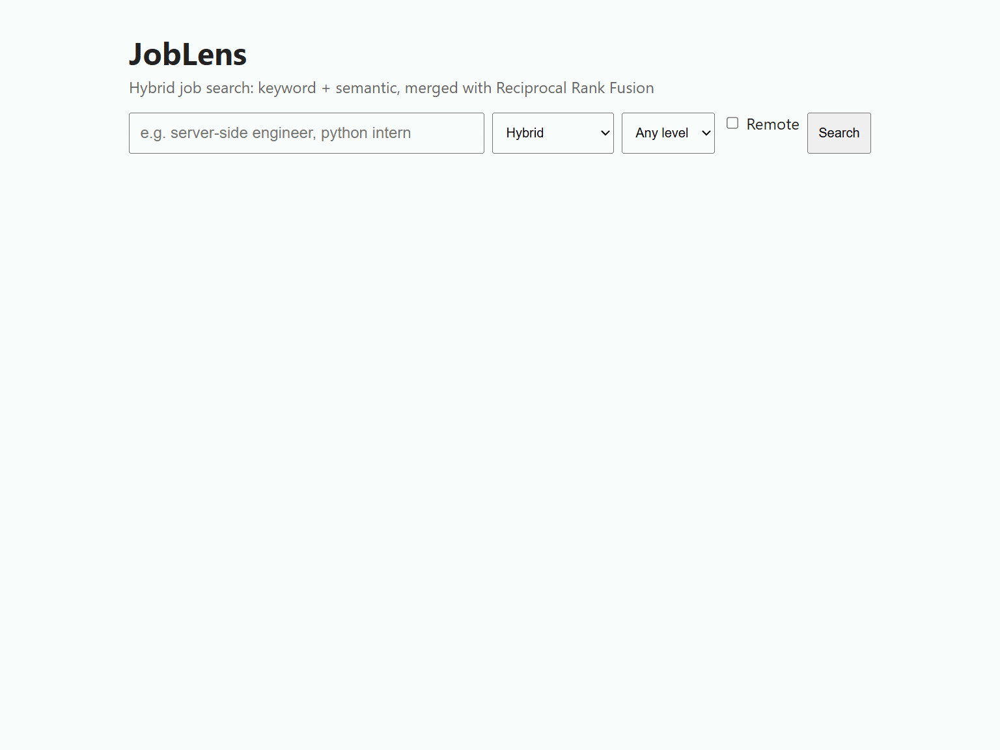
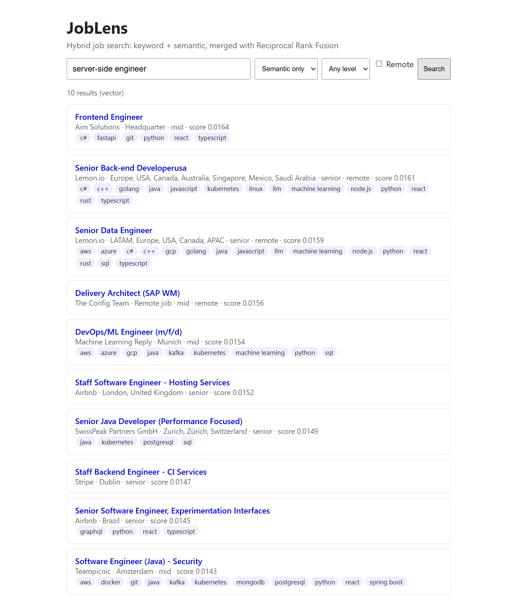
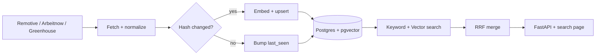
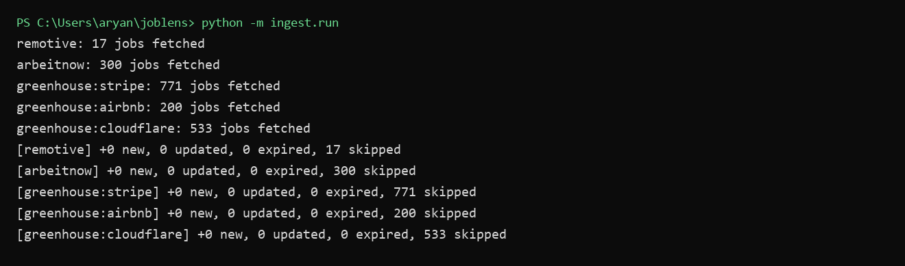

# JobLens


Hybrid job search engine: Postgres full-text search + pgvector semantic search, merged with Reciprocal Rank Fusion. The index refreshes itself every 6 hours.

## 🔗 Live demo: https://joblens-yvqo.onrender.com



> Hosted on a free tier, so the first search after idle may take a few seconds.

## Why hybrid?

Query: `server-side engineer`

| Keyword only | Semantic only |
|---|---|
|  |  |

Keyword search misses synonyms. Semantic search can miss exact terms like `C++`. Hybrid covers both.

## Features

- Ingests jobs from Remotive, Arbeitnow and Greenhouse boards
- Hash-based incremental updates: only new or changed jobs are re-embedded
- Expired jobs are detected and marked automatically
- Hybrid search: Postgres full-text + pgvector, merged with RRF
- SQL filters: remote, experience level, skills
- Scheduled ingestion via GitHub Actions, tests and CI

## Architecture



## Evaluation

Evaluated on 25 hand-labelled queries. Labels came from pooling the top results of all three methods, shuffling them, and judging relevance manually.

| Method | Recall@10 | MRR |
|---|---|---|
| Keyword (FTS) | 0.53 | 0.64 |
| Semantic (vector) | 0.72 | 0.71 |
| Hybrid (RRF) | 0.74 | 0.66 |

Hybrid has the best recall (0.53 → 0.74 over keyword-only). Semantic has slightly better MRR. With only 25 queries, the gap between semantic and hybrid is within noise, so I don't claim one beats the other.

## Incremental ingestion

Each run hashes every job and only embeds what changed. Jobs missing from a successful fetch are marked `expired`, scoped per source so an API outage can't wipe data. A GitHub Actions cron job runs this every 6 hours.



## API

```
GET /search?q=python backend&mode=hybrid&remote=true&level=junior&skills=python,docker
```

| Param | Values |
|---|---|
| `q` | search text (required) |
| `mode` | `hybrid` (default), `fts`, `vector` |
| `remote` | `true` / `false` |
| `level` | `intern`, `junior`, `mid`, `senior` |
| `skills` | comma-separated, e.g. `python,docker` |
| `limit` | 1–50 (default 10) |

Interactive docs: `/docs`

## Design decisions

- **Hybrid search:** keyword search is exact, vector search understands meaning, and each covers the other's weakness.
- **RRF on ranks, not scores:** `ts_rank` and cosine distance are on different scales, so I fuse ranks instead.
- **Hash-based updates:** embedding is the slow step, so unchanged jobs are skipped entirely.
- **Idempotent upserts:** a unique key on `(source, external_id)` makes re-runs safe.
- **Per-source expiry and empty-fetch guard:** a failing API never expires good data.
- **fastembed (ONNX):** the same MiniLM model as sentence-transformers, but light enough for a 512 MB free host.
- **HNSW index:** approximate nearest neighbour, trading a little accuracy for speed.

## Limitations and next steps

- Evaluation set is small (25 queries), so small differences are noise
- Skill extraction uses a fixed keyword list, not a real taxonomy
- Strict filters on vector search can return fewer than 10 results
- Next: cross-encoder reranker, query expansion, weighted RRF, pagination, user feedback signals

## Project structure

```
app/          FastAPI app + search logic + search page
ingest/       fetchers, skill extraction, incremental pipeline
db/           SQL migrations
evaluation/   labelling and Recall@10 / MRR scripts
tests/        pytest suite
```

## Run locally

```bash
docker compose up -d
pip install -r requirements.txt
python -m ingest.run
uvicorn app.main:app --reload
```

Open http://localhost:8000. Run the tests with `python -m pytest -q`.

## Stack

Python · FastAPI · Postgres + pgvector · fastembed · Docker · GitHub Actions · Render · Neon
