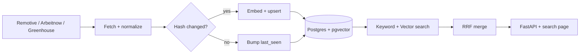

# JobLens


Hybrid job search using PostgreSQL full-text search and pgvector semantic
search, merged with Reciprocal Rank Fusion.

**Live demo:** Not deployed yet. A Neon connection string and Render service
configuration are required before a public demo can be linked.

**Demo GIF:** To be recorded after deployment.

## Architecture



## Evaluation

The evaluation set contains 30 queries. Labels are created from pooled top-10
results from FTS, vector, and hybrid search, then judged manually.

Relevance labels and Recall@10/MRR results are pending manual judging. The
evaluation table will be added after at least 25 queries have relevant jobs
labeled.

## Incremental ingestion

Unchanged jobs skip re-embedding and only refresh `last_seen`. A verified
second run on the local dataset reported:

```text
[remotive] +0 new, 0 updated, 0 expired, 15 skipped
[arbeitnow] +0 new, 0 updated, 0 expired, 300 skipped
[greenhouse:stripe] +0 new, 0 updated, 0 expired, 771 skipped
[greenhouse:airbnb] +0 new, 0 updated, 0 expired, 200 skipped
[greenhouse:cloudflare] +0 new, 0 updated, 0 expired, 513 skipped
```

## Design decisions

- **Hybrid retrieval:** keyword search handles exact technologies and terms,
  while semantic search can find related concepts such as backend work for a
  "server-side engineer" query.
- **Rank fusion:** FTS rank and cosine distance use different scales, so the
  search combines result ranks with Reciprocal Rank Fusion rather than adding
  incomparable raw scores.
- **Hash-based updates:** unchanged job content reuses its stored embedding;
  jobs missing from a successful source fetch expire only within that source.
- **FastEmbed:** ONNX embeddings provide 384-dimensional vectors for pgvector
  without requiring a hosted embedding service.

## What I'd improve

- Add a cross-encoder reranker and query expansion.
- Improve the skill taxonomy and support pagination.
- Incorporate user feedback signals into ranking.

## Run locally

Start PostgreSQL with pgvector:

```bash
docker compose up -d
```

Create and activate a virtual environment, then install dependencies:

```bash
python -m venv venv
# Windows PowerShell: .\venv\Scripts\Activate.ps1
# macOS/Linux: source venv/bin/activate
pip install -r requirements.txt
```

Ingest jobs and start the API from the repository root:

```bash
python -m ingest.run
uvicorn app.main:app --reload
```

Open [http://localhost:8000](http://localhost:8000) for the search page or
[http://localhost:8000/docs](http://localhost:8000/docs) for the API explorer.
The first model load/download can take a little while.

## Docker

Build and run the web app with Docker after setting `DATABASE_URL` to a
PostgreSQL database containing the schema and ingested jobs:

```bash
docker build -t joblens .
docker run --rm -p 8000:8000 -e DATABASE_URL="$DATABASE_URL" joblens
```

The container preloads the embedding model during image build and warms it
when the app starts.

## Tests and automation

Run the unit tests with:

```bash
python -m pytest -q
```

GitHub Actions runs tests on pushes and pull requests. Ingestion can be
started manually from Actions when the repository `DATABASE_URL` secret points
to the intended database. The scheduled trigger remains disabled until a
cloud database and secret are configured.
